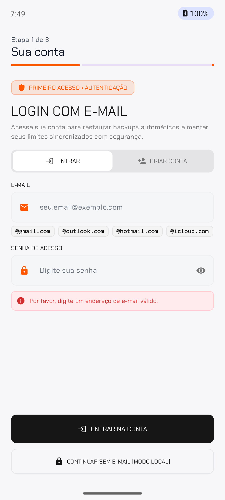
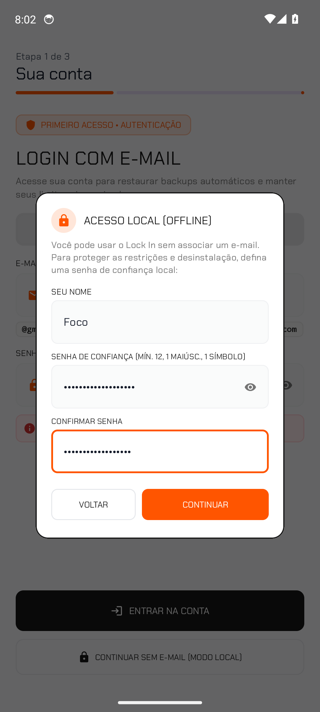

# Lock In 🔒

**App Android de foco extremo contra distrações** — controle total do tempo de tela com bloqueio inquebrável, rotinas inteligentes e ilha flutuante sempre visível.

---

## 📱 Capturas de Tela

| Login / Primeiro acesso | Acesso local (offline) |
|:---:|:---:|
|  |  |

*Capturas reais do app rodando em Android 14 (emulador 1080×2400). Novas telas serão adicionadas conforme forem capturadas.*

---

## 🚀 Funcionalidades Principais

### ⏱️ Timer Contínuo (v1.3+)
- **Sem pausa**: o tempo conta continuamente enquanto o app monitorado está em foreground
- Não importa se o vídeo está pausado, no feed ou em tela cheia — o tempo sempre conta
- Quando o tempo acaba, o bloqueio é ativado instantaneamente

### 🎯 Modos de Limite
| Modo | Descrição |
|------|-----------|
| **Tempo Absoluto** | Limite total diário (ex: 15 min/dia) |
| **Somente Shorts/Reels** | Limita apenas vídeos curtos (TikTok, Reels, Shorts, Kwai) |
| **Vídeo Longo** | Permite vídeo longo, bloqueia apenas shorts |
| **Por Grupo** | Limite compartilhado entre vários apps (ex: todas as redes sociais = 1h) |

### 📅 Rotinas Inteligentes (v1.2+)
- **Modo Dispositivo Inteiro**: bloqueia o telefone todo em horários definidos
- **Modo Por Apps**: bloqueia **vários apps de uma vez** (seleção múltipla)
- Dias da semana personalizáveis
- Até 3 apps de emergência permitidos durante o bloqueio

### 🏝️ Ilha Flutuante Sempre Visível
- Contador regressivo em tempo real
- Barra de progresso visual
- Cores dinâmicas: verde → âmbar → vermelho (urgente)
- Posicionamento e tamanho personalizáveis
- Modo demo para testes

### 🛡️ Níveis de Bloqueio (Anti-Bypass)
| Nível | Repetições de Senha | Desbloqueios Diários | Proteção Extra |
|-------|---------------------|----------------------|----------------|
| **Básico** | 1 | 3 | — |
| **Determinado** | 3 | 2 | — |
| **Obcecado** | 5 | 1 | **Bloqueio Absoluto de Instalação** (irreversível) |

### 🔐 Frases de Desafio (Desbloqueio Consciente)
- Digitação **exata** (sem tolerância a typos)
- 3 tentativas apenas
- Texto em vermelho **apenas na 1ª falha** nas palavras erradas
- Frases motivacionais personalizáveis

### 🌐 Bloqueio de Sites + DNS
- Lista negra de domínios (funciona em todos os navegadores)
- VPN local (DNS sinkhole) — sem proxy externo
- Detecção de DoH (DNS over HTTPS) e bloqueio automático
- Funciona offline

### 🛑 Proteção Anti-Desinstalação
- Bloqueio na Play Store / instalador do sistema
- Proteção de Admin de Dispositivo
- Modo "Obcecado" = irreversível (só factory reset remove)

### 👥 Modo Amigos (Festa)
- Crie grupos com amigos
- Aprovação mútua para instalar apps ou estender tempo
- Sincronização via ntfy.sh (privado, sem servidor próprio)

---

## 📋 Requisitos
- Android 8.0 (API 26) ou superior
- Permissões necessárias (guiadas na primeira execução):
  - **Acessibilidade** (detectar apps em foreground)
  - **Uso de Apps** (estatísticas de uso)
  - **Sobrepor outros apps** (ilha flutuante)
  - **Notificações** (alertas de tempo)
  - **Admin de Dispositivo** (anti-desinstalação)
  - **VPN** (bloqueio de sites via DNS)

---

## 📥 Instalação

### Opção 1: Download Direto (APK)
1. Baixe o `app-debug.apk` mais recente em [Releases](https://github.com/daadvi/Lock-In/releases)
2. Permita "Instalar apps desconhecidos" para seu navegador/gerenciador de arquivos
3. Instale e conceda todas as permissões guiadas pelo app

### Opção 2: Compilar do Fonte
```bash
git clone https://github.com/daadvi/Lock-In.git
cd Lock-In
./gradlew assembleDebug
# APK em app/build/outputs/apk/debug/app-debug.apk
```

---

## 🎮 Como Usar (Guia Rápido)

### 1. Configurar Limite por App
```
Aba "Apps" → Selecione app → Defina limite (ex: 15 min) → Escolha modo (Absoluto / Shorts / Longo) → Salvar
```

### 2. Criar Rotina (Bloqueio Agendado)
```
Aba "Rotinas" → "+" → Escolha "Apps Específicos" → Marque vários apps → Defina horário/dias → Salvar
```

### 3. Configurar Nível de Bloqueio
```
Aba "Configurações" → "Nível de Bloqueio" → Escolha: Básico / Determinado / Obcecado
```

### 4. Frases de Desafio Personalizadas
```
Configurações → "Frases de Desafio" → Adicione suas frases motivacionais
```

### 4. Bloqueio de Sites
```
Aba "Sites" → "+" → Digite domínio (ex: youtube.com) → Salvar
```

---

## 🏗️ Arquitetura Técnica

### Stack
- **Kotlin** + **Coroutines** + **Flow**
- **Room** (banco de dados local)
- **Hilt** (injeção de dependência)
- **Jetpack Compose** (UI)
- **WorkManager** / **AlarmManager** (agendamento)
- **VpnService** (DNS sinkhole)
- **AccessibilityService** (detecção de foreground)

### Módulos Principais
| Módulo | Responsabilidade |
|--------|------------------|
| `LimitTimerManager` | Timer central, contagem, transições |
| `LockInAccessibilityService` | Detecção de foreground, vídeo, bloqueio |
| `FloatingIslandService` | Overlay persistente (ilha) |
| `FocusTimeManager` | Rotinas, agendamento, alarmes |
| `ScreenTimeManager` | Limite diário de tela |
| `PlayStoreBlacklistManager` | Blacklist de instalação |
| `WebsiteBlacklistManager` / `LockInVpnService` | Bloqueio de sites (DNS) |
| `DailyResetManager` | Reset diário à meia-noite |
| `BankingSecurityHelper` | Isolamento apps bancários |
| `FriendsPartyManager` / `FriendsPartyCloudClient` | Modo amigos (ntfy.sh) |

### Segurança
- **Zero rede síncrona na main thread** (OkHttp + Coroutines IO)
- **SharedPreferences apenas `.apply()`** (async)
- **Room com caches em memória** (evita I/O repetido)
- **StrictMode penalidade log** no build debug
- **KSP** para geração de código (Room, Hilt, Serialization)

---

## 🧪 Testes
```bash
# Testes unitários (Robolectric + JUnit)
./gradlew testDebugUnitTest

# Testes de instrumentação (emulador)
./gradlew connectedAndroidTest
```

**Cobertura**: 230+ testes (unit + integração)
- Políticas de bloqueio
- Persistência de rotinas
- Recuperação de senha
- Backup/restore
- Edge cases de ANR

---

## 📦 CI/CD
- **GitHub Actions**: build, testes, lint, APK
- **Artifacts**: `app-debug.apk` a cada push
- **Release automático**: tag `v*` → publica APK + notas

---

## 📄 Licença
MIT License — veja [LICENSE](LICENSE)

---

## 🤝 Contribuindo
1. Fork o repositório
2. Crie branch: `git checkout -b feature/nova-funcionalidade`
3. Commit: `git commit -m 'feat: descrição da feature'`
4. Push: `git push origin feature/nova-funcionalidade`
5. Abra Pull Request

---

## 📞 Suporte
- **Issues**: [GitHub Issues](https://github.com/daadvi/Lock-In/issues)
- **Discussões**: [GitHub Discussions](https://github.com/daadvi/Lock-In/discussions)

---

## 🙏 Agradecimentos
- Comunidade Kotlin/Android
- ntfy.sh (infraestrutura de notificação para modo amigos)
- Contribuidores e testadores

---

**Lock In** — *Seu tempo, seu controle.* 🔒